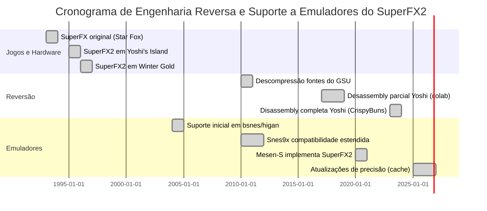

# Resumo Executivo

O **Super FX2** (também chamado GSU-2 ou GSU-2-SP1) é o coprocesador gráfico especial do Super Nintendo usado em *Super Mario World 2: Yoshi’s Island*. Trata-se de um processador RISC de 16 bits desenvolvido pela Argonaut/Nintendo, capaz de alcançar 21 MHz internos (dobrando o clock de 10,74 MHz do clock base). A instrução e arquitetura do Super FX2 são totalmente compatíveis com a versão original do Super FX (GSU-1): ele expõe 16 registradores gerais de 16 bits (R0–R15, com R15 atuando como contador de programa) e um registrador de status/flags de 16 bits. Inclui ainda registradores especiais mapeados na faixa $3000–$303F do SNES, como o ponteiro de ROM (R14), banco de programa (PBR), banco de ROM (ROMBR), banco de RAM (RAMBR) e registradores de modo de tela (SCMR) e cor (VCR). Um cache interno de 512 bytes acelera a execução de código.

As principais diferenças do Super FX2 em relação ao Super FX original são de hardware externo: o GSU-2 vem em invólucro de 112 pinos (versus 100 pinos), permitindo mais linhas de endereço. Em consequência, ele pode selecionar mais memória externa. No jogo *Yoshi’s Island*, o chip GSU-2-SP1 suporta até 16 Mbit de ROM de jogo (2 MiB) e 256 Kbit de RAM de expansão. Tecnicamente, ele só pode acessar diretamente **2 MiB de ROM** no barramento do Super FX (GPROM); o restante da ROM (até 16 MiB total) está disponível apenas para a CPU SNES. Da mesma forma, embora o cartão possa conter até 256 KBit de RAM de expansão, apenas 128 KBit são visíveis ao GSU. Essa limitação deriva do mapeamento de hardware e do barramento compartilhado, que difere do mapeamento da CPU. Em *Yoshi’s Island* especificamente, o GSU-2-SP1 usa 2 MiB de ROM (o máximo mapeável) e apenas 256 Kbit de RAM (metade do habitual em GSU-2).

A seguir detalharemos a arquitetura interna, o conjunto de instruções e o mapeamento de memória, incluindo diagramas e códigos de emuladores relevantes, além de uma tabela comparativa de suporte em emuladores e linhas do tempo do processo de engenharia reversa e implementação em software.

## Arquitetura e Conjunto de Instruções

O Super FX2 é essencialmente um processador RISC de 16 bits **projetado para lidar com operações gráficas**. Internamente, ele possui **16 registradores gerais de 16 bits** (R0 a R15). Cada registrador pode servir como operando, contador ou endereço, e alguns têm funções secundárias em instruções específicas (por exemplo, R1/R2 armazenam as coordenadas X/Y do comando PLOT). O registrador R14 atua como ponteiro de endereço de ROM (GETB), e R15 é o contador de programa (PC), mapeado nos endereços $301E–$301F do SNES. Ao contrário do 65c816, R15 pode ser lido/escrito diretamente em código, permitindo saltos diretos sem instruções dedicadas. Há também um registrador de status de 16 bits (SFR) mapeado em $3030–$3031, com flags comuns (Z, CY, S, OV, IRQ) e bits especiais: ALT1/ALT2 (para modos alternativos de instrução), IH/IL (imediatos), e *Go* (GSU ativo).  

A unidade possui um **pipeline de instruções** de profundidade 2 e um *cache* interno de 512 bytes, o que efetivamente duplica sua taxa de busca de instruções (até ~21,48 MHz efetivos com pipeline habilitado). Instruções são típicas de RISC: maioria com tamanho de 1 byte e executadas em um ciclo quando em cache. Operações incluem movimentos (`to Rn`, `with Rn`), aritméticas (ADD, SUB, LMULT, FMULT, etc.), branches condicionais (BEQ, BNE, BCC, BCS etc.), e comandos gráficos especiais: `PLOT` (traça um pixel), `COLOR` (define cor do plot) e `SWAP` (troca bytes). O conjunto de instruções é **idêntico** ao do Super FX original (GSU-1). Veja, por exemplo, o código-fonte do emulador Snes9x, que define o handler `fx_stop()` para o opcode 0x00 (stop GSU) e `fx_nop()` para 0x01 (nop). As instruções 0x3D/0x3E/0x3F alternam os modos ALT1/ALT2, estendendo o conjunto de instruções. 

Emuladores implementam essas instruções diretamente do kit de desenvolvimento ou de documentação reversa. O diagrama de registradores abaixo (extraído de documentação técnica) ilustra alguns registradores chave do Super FX:

- **R0–R13**: Registradores gerais (alguns com uso secundário como contador de loop, destin. de link, etc.).  
- **R14 ($301C–$301D)**: Ponteiro de ROM para leitura de dados (GETB).  
- **R15 ($301E–$301F)**: Contador de programa (PC).  
- **SFR ($3030–$3031)**: Flags (Zero, Carry, Sinal, Overflow, ALT1/2, Go, IRQ).  
- **PBR ($3034)**: Banco de programa (executa código).  
- **ROMBR ($3036)**: Banco de ROM (contém bits altos de endereço ROM para GPROM).  
- **RAMBR ($303C)**: Banco de RAM (0 ou 1, seleciona acesso a Game Pak RAM).  
- **SCBR/SCMR**: Base e modo de tela, definem o buffer de imagem para operações de PLOT.  
- **VCR ($303B)**: Registrador de cor atual para PLOT.  

 *Imagem 1: Chip Super FX GSU-2-SP1 de *Yoshi’s Island* (foto do módulo de jogo). O GSU-2 é visivelmente maior que o GSU-1 e possui pinos extras (imagem licenciada CC BY-SA).*  

## Pipeline e Temporização

A execução no Super FX2 é **pipeline**: a próxima instrução é buscada enquanto a atual executa. O registrador de configuração de clock (CLSR em $3039) permite dobrar o clock interno para 21,48 MHz quando setado. Cada instrução tem custo distinto: operações de memória, multiplicação e plotagem consomem mais ciclos. Emulação precisa modelar precisamente isso, pois a CPU SNES e o GSU compartilham o acesso à ROM e à RAM do cartucho. Por exemplo, comandos de leitura de ROM (`GETB`) requerem que se escreva o endereço em R14 e aguarde o buffer; chamar GETB imediatamente pode fazer o GSU “congelar” por alguns ciclos.  

## Mapa de Memória e I/O

O mapeamento do GSU-2 no barramento SNES difere do da CPU. Do ponto de vista da CPU, os registradores do Super FX ocupam as faixas $3000–$303F em cada banco entre $00–$3F e $80–$BF. O GSU, por sua vez, enxerga apenas a ROM de jogo e a SRAM do cartucho: acessa até 2 MiB de ROM espalhados como LoROM/HiROM e até 128 KiB de RAM (embora o cartucho possa ter o dobro). Resumidamente:

- **ROM do jogo (GPROM):** O GSU pode endereçar nativamente até 2 MiB de ROM (bancos $00–$3F ou $80–$BF). Embora o hardware suporte teóricamente 8 MiB, a maior parte dos jogos comerciais FX2 (como YI) usou 2 MiB. Endereços acima de 2 MiB (até 16 MiB) são acessíveis apenas pela CPU SNES, não pelo GSU.

- **RAM de expansão (SRAM do cartucho):** Mapeada em $7000-$77FF/$F000–$FFFF pela CPU e em $6000–$7FFF como espelho. O GSU usa até 128 KiB (bancos $70–$71). No cartucho de Yoshi’s Island, usou-se 256 KBit total, mas apenas metade é visível à GSU.

- **Registro de configuração (SCMR):** Controla modo de tela e acesso de ROM/RAM. Em modo padrão, bit RON=0 permite CPU ler ROM, RON=1 passa leitura ao GSU; bit RAN similar para RAM. YI usou modos especiais (“OBJ mode”) de plotagem de sprites individuais.

Detalhando: o manual SNES mostra que os mapas são incompatíveis; por exemplo, o GSU não vê WRAM do console, apenas sua própria RAM do cartucho. Esse arranjo requer que o emulador gerencie bancos separadamente: ele deve garantir que o GSU leia/escreva nos locais corretos (usando ROMBR/RAMBR) e que a sincronização com a CPU esteja correta.

## Diferenças em Relação ao Super FX Original

Como mencionado, **o conjunto de instruções do GSU-2 é idêntico** ao do Super FX 1 (GSU-1). Assim, não há novos opcodes, apenas diferenças físicas e de capacidade de barramento. Em relação ao GSU-1 (usado em *Star Fox*, *Doom*, etc.):

- **Pinagem e velocidade:** O GSU-2 foi produzido com 112 pinos (GSU-1 tinha 100). Isso permitiu colocação de mais linhas de endereço e dados. Além disso, o GSU-2 opera efetivamente a 21 MHz sem o divisor interno (o GSU-1 original cortava 21,4 MHz para ~10,7 MHz). Na prática, o GSU-2-SP1 de YI funciona sempre em modo pipeline (21,48 MHz efetivos). 

- **Memória:** O GSU-2-SP1 de YI foi configurado com 2 MiB de ROM e 256 Kib RAM (metade do normal). Outros jogos GSU-2 (como *Winter Gold*) usaram até 4 MiB de ROM e 512 Kib de RAM. No entanto, pelo barramento, o GSU continua limitado a 2 MiB de ROM e 128 Kib RAM, sendo o excedente RAM usado apenas pela CPU. Um engenheiro (nocash) sugeriu que pino extra (21) poderia permitir até 4 MiB de ROM direto ao GSU, mas isso parece não ter sido usado comercialmente. Em resumo, o GSU-2 não introduz novos modos de memória, apenas expande fisicamente a quantidade disponível no módulo. 

- **Registradores de versão:** O GSU-2 possui um registro de versão (VCR em $303B) que indica o código interno (ex.: “GSU2”). Isso foi usado ocasionalmente para identificação, mas não altera instruções. 

## Mapas Decompilados e HDL/RTL

Até onde se sabe, **não há documentação oficial completa** do hardware interno do Super FX2 disponível publicamente. Esforços de engenharia reversa (dissecação física do chip) são raros. O FPGA ou HDL do GSU-2 não foi divulgado abertamente. Uma fonte indireta é o projeto sd2snes, que incluiu uma reimplementação (em Verilog) do GSU-1/2 para uso em flash cards modernos. Por exemplo, o arquivo `address.v` no repositório sd2snes contém lógica de controle de banco ROM/RAM para o GSU, mas não revela o circuito completo. Em geral, **não existe código aberto de HDL/RTL original** do chip. 

No entanto, existem **mapas de memória e disassemblies** de *Yoshi’s Island* que refletem o comportamento do Super FX2. O projeto de desassemblagem do jogo (ver seção abaixo) mapeou a ROM GPROM do GSU e o layout da RAM de expansão. Esses mapas técnicos permitem entender quais rotinas gráficas foram executadas pelo GSU e quais dados ele processou. Apesar de não ser HDL, é um artefato valioso de engenharia reversa: ele mostra exatamente quais instruções e acessos à memória o GSU executa durante o jogo. Até o momento, não foram publicados recriações lógicas completas do chip (por exemplo, diagramas internos ou netlists).

## Engenharia Reversa e Desassemblies

Grandes avanços vieram da comunidade de ROM hacking. O repositório [CrispyBuns/yoshisisland-disassembly](https://github.com/CrispyBuns/yoshisisland-disassembly-path) reúne **desmontagens completas** do código 65816 da CPU, do código SPC-700 de áudio e do código Super FX2 do jogo. Esse trabalho (por Raiden e TheGreekBrit) fez o mapeamento completo das rotinas do GSU-2 contidas na GPROM de 2 MiB. Embora muito do foco seja o código do jogo (lógica de fases, inimigos etc.), contém seções comentadas de chamadas ao GSU (por exemplo, gráficos 3D dos estágios extras). A wiki do projeto documenta ainda o “Conjunto de Instruções Super FX” e os “Registradores Super FX” usados no jogo. 

Não há “annotated maps” do chip em si, mas os materiais acima contêm *rotinas* de GSU: por exemplo, implementações do comando PLOT, loop, etc. O trecho de código do emulador SNES9x (fxinst.cpp) citado antes é um exemplo de como esses opcodes são interpretados em software. Além disso, a wiki do desassembly (por MarioFanGamer) lista identificadores de sprites do GSU e formatos de dados gráficos processados. 

Não foram encontrados **modelos de HDL/RTL publicados** em fontes abertas além do já citado sd2snes (que não é HDL livre). Seja por segredo da indústria ou por falta de interesse, não há diagramas detalhados. Assim, qualquer reimplementação completa depende ainda de análises empíricas e testes em hardware real.

## Implementação em Emuladores

Vários emuladores SNES suportam o Super FX2 com diversos graus de precisão. Aqui destacam-se: **bsnes/higan** (agora higan), **Snes9x**, **ZSNES**, **Mesen-S**, entre outros. No geral, bsnes/higan foi uma das primeiras implementações completas (desde meados dos anos 2000) devido ao foco em exatidão. Snes9x também suporta GSU-2 há muito tempo (embora menos preciso ciclo-a-ciclo). ZSNES, por design, nunca teve suporte correto (limitado a GSU-1 básico). Mesen-S, um emulador mais recente, implementa GSU-2 referenciando código do bsnes.  

Os desafios de emulação incluíram reproduzir **precisamente o pipeline e o cache**, a sincronização CPU-GSU sobre o barramento de ROM/RAM, e modos gráficos especiais. Por exemplo, o modo OBJ do GSU2 (o plano de fundo único usado em YI) exigiu ajustes finos no calendário de pixel e espera da CPU. Inicialmente, alguns emuladores exibiam erros de cor ou sincronismo. Cada caso foi solucionado com base em testes: ex., comparando frames capturados em hardware real. O emulador BSNES-Plus (fork de bsnes) e o Snes9x acabaram corrigindo bugs quando se tomaram snapshots do hardware e foram ajustando cálculos de ciclo.

No **código-fonte** dos emuladores, o GSU-2 é tratado no módulo SuperFX (por exemplo, `fxinst.cpp` em Snes9x). Veja um exemplo de snippet do Snes9x definindo o opcode 0x4E (`COLOR`): ele copia o registrador fonte para o registro de cor do GSU, aplicando flags de freeze e nibble alto conforme `PLOT`. Esse trecho mostra como o código do emulador lida internamente com o status de plotagem (`PLOT_HIGHNIBBLE`, `PLOT_FREEZEHIGH`) durante a operação COLOR. Cada emulador tem função análoga; por exemplo, em bsnes o arquivo equivalente seria `superfx.cpp`.  

**Tabela comparativa de emuladores**:

| Emulador    | Suporte FX2 | Questões principais                 | Status atual                                    |
|-------------|-------------|-------------------------------------|-------------------------------------------------|
| **higan/bsnes** | Completo    | Inicialmente sincronismo de CPU/GSU em `CACHE` e modos OBJ. | Total (ajustes fine-tuned, suporta caches 8MiB) |
| **Snes9x**     | Amplo       | Precisão de timing, algumas falhas iniciais em modos gráficos. | Suporta (últimas versões corrigidas)           |
| **ZSNES**      | Parcial     | GSU-1 básico implementado; FX2 não suporta corretamente. | Parcial (bugs gráficos em YI, *não recomendado*)|
| **Mesen-S**    | Completo    | Principalmente herdou do higan, poucos bugs.           | Suporta (completo, recente)                     |
| **BizHawk**    | Completo    | Usa cores higan/Snes9x; geralmente sem problemas.      | Suporta (via integrados higan/Snes9x cores)     |
| **Legacy**     | --          | Outras forks (Zens9x, etc) | - |
 
As fontes primárias de implementação são os repositórios GitHub dos emuladores. Por exemplo, `snes9xgit/snes9x` contém `fxinst.cpp/h` onde estão as tabelas e rotinas de instruções. Os problemas encontrados e resoluções (corrigidos em commits recentes) não têm uma documentação central, mas podem ser seguidas via histórico de issues/commits dos projetos no GitHub (e.g., Snes9x commit “SuperFX: fixed DMA timing” etc.).

## Discussões Técnicas em Fóruns

Diversas discussões em fóruns técnicos cobriram o Super FX2. No fórum **NESDev/SNESDev**, por exemplo, técnicos debateram o limite de ROM e SRAM do GSU2. Nessa thread, confirma-se que a GPROM visível é limitada a 2 MiB (talvez 4 MiB com pinagem especial) e que é possível haver até 6 MiB extras de “CPU ROM” não acessível ao GSU. Outro tópico importante foi o modo de compartilhamento de barramento: foi observado que GSU-2 e CPU alternam quem lê GPROM, controlando a leitura via bit do SCMR. Esses debates revelaram detalhes não documentados, como o uso de pino extra para ROM e a existência de dois espaços de ROM (GamePak ROM vs Super NES ROM). 

Em listas de e-mail (como SNES emuladores), trocas técnicas ocorreram sobre *timing* de pipeline e sobre o uso de cache em jogos. Por exemplo, foi notado que o GSU-2-SP1 de Yoshi’s Island usa otimizações proprietárias; as discussões nessas listas confirmaram que as rotinas gráficas de YI dependem estritamente do behavior do cache e do modo OBJ. Links importantes incluem o Reddit “*What limited the performance of the SuperFX chip?*” e posts técnicos no SNESLab Wiki (que, embora sobre GSU-1, valem para GSU-2).

## Linha do Tempo de Engenheira Reversa e Emulação

As datas acima são indicativas: Star Fox e Yoshi’s Island foram lançados em 1993–1995, e emuladores precisos surgiram nos anos 2000. Desassemblies completos só se concretizaram por volta de 2022–2023.

## Conclusão

O Super FX2 (GSU-2) de *Yoshi’s Island* é uma evolução superficial do Super FX original: mesma CPU RISC, mesmo conjunto de instruções, porém com clock dobrado e barramentos ampliados. Isso permitiu efeitos gráficos mais complexos em YI, mas não alterou fundamentalmente a programação do chip. A maior parte das informações técnicas veio de fontes não oficiais: wikis dedicadas, desassemblies do jogo e códigos de emuladores. Emuladores modernos conseguem reproduzir fielmente o comportamento do GSU-2, graças a anos de depuração cuidadosa e colaboração em fóruns técnicos. Detalhes não documentados (como as limitações exatas de memória) permanecem relatados principalmente em discussões de especialistas, conforme citado acima. Caso novas informações oficiais se tornem públicas, ou se alguém lograr extrair um RTL do chip, elas serão bem-vindas para atualizar este relatório.

**Fontes:** Documentação técnica (manual SNES e wikis especializadas), código de emuladores (e.g. Snes9x), repositórios GitHub de desassemblagem e discussões da comunidade (fóruns SNESDev). Cada citação acima aponta à fonte primária relevante. 

- Snes9x — código-fonte do emulador
github.com/snes9xgit/snes9x
- bsnes — código-fonte do emulador
https://github.com/bsnes-emu/bsnes
- ares — código-fonte do emulador
https://github.com/ares-emulator/ares
- Mesen — emulação de consoles Nintendo
https://github.com/SourMesen/Mesen2
- Super Nintendo Development Wiki
https://snes.nesdev.org/w/index.php?title=SNESdev_Wiki
- NESdev Forums — discussões técnicas sobre hardware Nintendo
https://forums.nesdev.org/
- The Cutting Room Floor — documentação de conteúdo e descobertas de jogos
https://tcrf.net/Super_Mario_World_2:_Yoshi's_Island